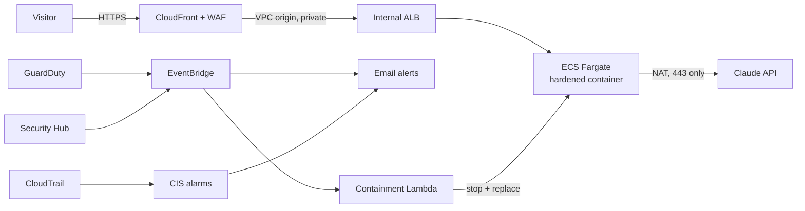

# RAG Doc Q&A: a secure AI platform on AWS

**Ask questions about your documents and get answers with verifiable citations, running on a hardened,
continuously monitored AWS platform built entirely with Terraform.**

Upload a PDF, Markdown or text file and ask a question. Claude answers *only* from your documents, and every sentence
links back to the exact passage it came from. Behind it sits an enterprise-style AWS security baseline:
CloudTrail, GuardDuty, Security Hub, Config, Inspector and WAF, wired into automated alerting and incident response.

**Live demo:** `https://<id>.cloudfront.net` · **Docs:** [Security architecture](docs/SECURITY.md) ·
[Incident response](docs/INCIDENT_RESPONSE.md) · [Threat model](docs/THREAT_MODEL.md) · [DR plan](docs/DISASTER_RECOVERY.md)

**Stack:** Python · FastAPI · Claude Opus 5 · Docker · Terraform · AWS (CloudFront, WAF, ALB, ECS Fargate, ECR, KMS,
SSM, CloudTrail, CloudWatch, GuardDuty, Security Hub, Config, Inspector, EventBridge, Lambda) · GitHub Actions

---

## Architecture



Full diagram and control mapping: [docs/SECURITY.md](docs/SECURITY.md).

The Terraform is split into three stacks, the way enterprise landing zones are organised:

| Stack | Purpose |
|---|---|
| `infra/bootstrap` | KMS-encrypted, versioned S3 bucket for Terraform state (native S3 locking) |
| `infra/security-baseline` | Account-wide security services, detective controls, alerting and reporting. Reusable for any workload |
| `infra/app` | The workload: two-tier VPC, CloudFront + WAF, internal ALB, ECS Fargate, containment automation, dashboard |

## Security highlights

**Prevent**
- No public origin: the load balancer and containers are in private subnets, reachable only through CloudFront + WAF via a VPC origin
- WAF: AWS IP reputation, OWASP Common Rule Set, Known Bad Inputs, and edge rate limiting on the costly LLM endpoint
- Hardened containers: read-only root filesystem, non-root, all Linux capabilities dropped, no shell access, no package manager
- Least privilege: the app's IAM role has **zero** permissions; CI deploys through GitHub OIDC with no stored AWS keys
- Encryption everywhere with customer-managed KMS keys; the API key exists only in SSM, never in code, images or state
- Strict CSP (no `unsafe-inline`), HSTS preload and security headers at the edge and in the app

**Detect**
- CloudTrail (multi-region, integrity-validated) with **15 CIS Benchmark alarms**: root use, MFA-less sign-in, IAM/network/trail changes
- GuardDuty with **ECS runtime monitoring** (crypto-mining, reverse shells), plus S3, malware and Lambda protection
- Security Hub continuously scoring the account against **AWS Foundational Security Best Practices** and **CIS v3.0**
- Inspector rescanning container images whenever a new CVE is published; Config recording every resource change
- A CloudWatch **Security Operations dashboard** and a weekly posture-report email with compliance score and top failing controls

**Respond**
- High-severity GuardDuty findings on the app automatically **contain the task**: forensic snapshot → tag → stop → clean replacement → alert. Failures land in a DLQ that pages a human
- Config **auto-remediates** open SSH and public S3 buckets within minutes
- A [runbook](docs/INCIDENT_RESPONSE.md) with four playbooks, and a **live incident-response drill**: `make ir-drill`

**Shift left (CI on every push):** unit tests · pip-audit · gitleaks · Checkov (IaC) · Trivy (image, blocking on fixable High/Critical) ·
CodeQL · Dependabot, with results in GitHub code scanning. Images ship with an SBOM and provenance, and tags are immutable.

**Before → after on the real AWS account:** no CloudTrail trail, threat detection or public-access block → full baseline;
Checkov first scan 59 failing → **685 checks passing, 0 failing**, with every exception justified in a
[risk register](docs/SECURITY.md#5-risk-acceptance-register).

## How the AI part works

1. Documents are split into ~1,200-character overlapping chunks and embedded locally with `bge-small-en-v1.5` (baked into the image, so no second API key).
2. The question is embedded, and the closest chunks are found by cosine similarity.
3. Those chunks go to Claude as `document` blocks with **citations enabled**, so each claim maps to an exact character span and citations can't be invented.
4. The system prompt keeps answers grounded and treats document text as data (prompt-injection hygiene). Refusals fall back server-side.

## Run locally

```bash
make install
cp .env.example .env        # add your ANTHROPIC_API_KEY
make run                    # http://localhost:8000
make test                   # 24 tests, no API calls needed
make scan                   # Checkov + Trivy + pip-audit, same gates as CI
```

## Deploy to AWS

Prerequisites: AWS CLI signed in, Terraform ≥ 1.10, Docker running, `jq`, an [Anthropic API key](https://console.anthropic.com/).

```bash
make secret                                   # API key -> SSM SecureString (prompted, never echoed)
cp infra/security-baseline/terraform.tfvars.example infra/security-baseline/terraform.tfvars   # set alert_email
make deploy                                   # bootstrap -> security baseline -> app; prints the URL
```

Confirm the SNS subscription email AWS sends you. After that: `make url` prints the site and dashboard, `make release` ships
code changes, `make ir-drill` rehearses incident response, and `make destroy` tears everything down.

**CI/CD:** set `github_repository = "<you>/rag-doc-qa"` in `infra/app/terraform.tfvars`, run `make app`, and add the
`github_deploy_role_arn` output as the repository secret `AWS_DEPLOY_ROLE_ARN`. Every green build on `main` then deploys automatically.

**Cost:** roughly **$3/day (~$90/month)** while running. The biggest items are the NAT gateway (~$37/month), ALB (~$20) and WAF (~$10);
the security services are mostly free for their first 30 days. Claude usage is capped by `DAILY_QUESTION_CAP`. Designed for
**demo mode**: deploy for showcases and interviews, `make destroy` afterwards, and rebuild in about 15 minutes.

## Project layout

```
app/                        FastAPI app: retrieval, Claude call, rate limits, UI
infra/bootstrap/            Terraform state bucket
infra/security-baseline/    CloudTrail, GuardDuty, Security Hub, Config, Inspector, CIS alarms, alerting, reporting
infra/app/                  VPC, CloudFront, WAF, ALB, ECS, KMS, containment Lambda, dashboard
scripts/                    release.sh (zero-downtime deploy), ir-drill.sh (incident drill)
docs/                       Security architecture, incident response, threat model, DR
tests/                      24 tests: app, retrieval, report Lambda, containment Lambda
.github/                    CI (tests + 5 security scanners), deploy (OIDC), CodeQL, Dependabot
```

## Roadmap

- **EKS deployment option:** Helm chart, Pod Identity, network policies, GuardDuty EKS runtime protection
- AWS Organizations: delegated security admin, all-region enablement, SCP guardrails
- Custom domain with an ACM certificate (closes RA-01/RA-02)
- Retrieval evaluation in CI (faithfulness and recall)
