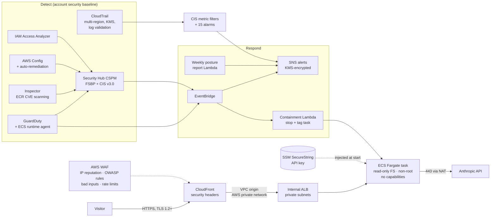

# Security Architecture

This document describes how the platform is secured: the architecture, the controls mapped to industry
frameworks, how threats are detected and responded to, and the risks deliberately accepted.

## 1. Architecture

**Layers of defence:**

| Layer | Controls |
|---|---|
| Edge | CloudFront (HTTPS only, HSTS preload, strict CSP), AWS WAF with managed threat-intel and OWASP rule groups, edge rate limiting on the expensive LLM endpoint |
| Network | Two-tier VPC; the load balancer and containers have no public IPs; ALB accepts traffic only from the CloudFront origin-facing prefix list; tasks accept traffic only from the ALB; egress restricted to 443; default security group denies all; VPC Flow Logs |
| Compute | Fargate (no hosts to patch), read-only root filesystem, non-root UID 10001, all Linux capabilities dropped, no ECS Exec shell, immutable image tags, root-owned code, no package manager in the image |
| Identity | Least-privilege task role with no permissions; execution role scoped to one SSM parameter; GitHub deploys via OIDC (no stored AWS keys), restricted to `main` and `iam:PassedToService`; IAM password policy; Access Analyzer |
| Data | KMS customer-managed keys with rotation for logs, images, CloudTrail, alerts and state; TLS-only bucket policies; S3 public access blocked account-wide; default EBS encryption; secrets never in code, images or Terraform state |
| Application | Answers grounded in documents with verifiable citations; prompt-injection instructions in the system prompt; per-visitor document isolation; upload type and size limits; per-IP and daily rate limits; spoof-proof client IP via `CloudFront-Viewer-Address` |
| Supply chain | Checkov, Trivy, pip-audit, gitleaks and CodeQL in CI, with results in GitHub code scanning; Dependabot; SBOM and provenance attestations on images; Inspector continuously rescans deployed images |
| Detection | CloudTrail, GuardDuty (including ECS runtime monitoring), Security Hub (AWS FSBP + CIS v3.0), Config, Inspector, CIS CloudWatch alarms, budget alerts |
| Response | Automated ECS task containment with forensic snapshot and DLQ, high-severity alerting, a runbook ([INCIDENT_RESPONSE.md](INCIDENT_RESPONSE.md)) and rehearsable drills (`make ir-drill`) |

## 2. Mapping to the AWS security services

| Service | How it's used here | Where |
|---|---|---|
| **CloudTrail** | Multi-region trail with global events, log-file integrity validation, KMS encryption, Glacier archiving after 90 days, streamed to CloudWatch Logs | `infra/security-baseline/cloudtrail.tf` |
| **CloudWatch** | 15 CIS Benchmark metric filters and alarms, findings metrics, service alarms, Security Operations dashboard, KMS-encrypted log groups with 1-year retention | `cis_alarms.tf`, `alerting.tf`, `infra/app/monitoring.tf` |
| **GuardDuty** | Detector with S3, EBS malware, Lambda network, EKS audit and Runtime Monitoring (agent managed in ECS Fargate tasks) | `guardduty.tf` |
| **Security Hub** | AWS Foundational Security Best Practices + CIS AWS Foundations v3.0, consolidated control findings, Critical/High alerting, weekly posture report | `securityhub.tf`, `reporting.tf` |
| **Inspector** | Enhanced scanning of ECR images (on push and when new CVEs are published), EC2 and Lambda | `inspector.tf` |
| **Config** | All resource types recorded; 15 organisation rules; automatic SSM remediation for open SSH and public S3 buckets | `config.tf` |
| **WAF** | CloudFront web ACL with IP reputation, Known Bad Inputs, Common Rule Set, Anonymous IP list (count mode) and two rate-based rules; full request logging with session IDs redacted | `infra/app/waf.tf` |
| **Security Incident Response** | Runbook defines when to engage the AWS Security Incident Response service / AWS Support, and the evidence to hand over | [INCIDENT_RESPONSE.md](INCIDENT_RESPONSE.md) |
| **Trusted Advisor** | Core security checks reviewed in the console as part of the weekly review (full API needs a Business support plan) | [INCIDENT_RESPONSE.md](INCIDENT_RESPONSE.md#weekly-review) |

## 3. Framework alignment

| NIST CSF 2.0 function | Implementation |
|---|---|
| **Govern** | Risk acceptance register (below), Terraform as the single source of truth, required-tags Config rule, budget guardrails |
| **Identify** | Config inventory, Access Analyzer, Inspector vulnerability inventory, threat model ([THREAT_MODEL.md](THREAT_MODEL.md)) |
| **Protect** | Network isolation, WAF, KMS everywhere, least-privilege IAM, hardened containers, CI security gates |
| **Detect** | GuardDuty, Security Hub, CIS alarms, Inspector, Flow Logs, WAF logs |
| **Respond** | EventBridge routing, automated containment, runbook, drills |
| **Recover** | Rebuild from IaC in ~15 minutes, ECS self-healing, circuit-breaker rollback ([DISASTER_RECOVERY.md](DISASTER_RECOVERY.md)) |

## 4. Account findings fixed by the baseline

Found during the initial assessment of the AWS account (October 2026), before the baseline was applied:

| Finding | Severity | Fix |
|---|---|---|
| No CloudTrail trail; no audit log beyond the 90-day event history | High | Multi-region, encrypted, validated trail with alarms |
| GuardDuty, Security Hub, Config, Inspector and Access Analyzer not enabled | High | Enabled and wired to alerting |
| No account-level S3 Block Public Access | High | Enabled account-wide |
| No IAM password policy | Medium | CIS-aligned policy (14+ characters, reuse prevention 24) |
| EBS default encryption off | Medium | Enabled |
| Day-to-day administration via an IAM user with long-lived access keys | Medium | **Recommendation:** move to IAM Identity Center (SSO) with short-lived credentials and remove the access keys |

Already compliant: root account MFA enabled, no root access keys, MFA on the admin IAM user.

## 5. Risk acceptance register

Checkov and Security Hub checks that are deliberately not met. Each has an owner decision and compensating controls.
Matching skips live in [`.checkov.yaml`](../.checkov.yaml).

| ID | Risk | Rationale | Compensating controls | Production action |
|---|---|---|---|---|
| RA-01 | CloudFront → ALB hop uses HTTP (CKV_AWS_2/103/378, Security Hub ELB.1) | No custom domain, so no ACM certificate for the ALB. The hop is a CloudFront **VPC origin** over AWS's private network to an internal ALB with no internet route | ALB is internal; SG allows only the CloudFront prefix list; viewer side is HTTPS-only | Add a domain, an ACM certificate on the ALB and `https-only` origin protocol |
| RA-02 | Default `*.cloudfront.net` certificate permits TLS 1.0 negotiation (CKV_AWS_174) | Minimum TLS can only be raised with a custom certificate | HSTS preload; modern clients negotiate TLS 1.3 | ACM certificate with `TLSv1.2_2021` |
| RA-03 | No deletion protection, cross-region replication or origin failover; `force_destroy` on log buckets | **Demo mode**: the platform is torn down between interviews to control cost | Everything is reproducible from Terraform; state is versioned | Enable deletion protection, S3 Object Lock on CloudTrail, cross-region log replication, multi-AZ NAT |
| RA-04 | No CloudFront or S3 server access logs | WAF logs every request with full headers; CloudTrail and Config cover bucket activity | WAF logging, CloudTrail, Config | Enable CloudFront standard logging v2 |
| RA-05 | Lambdas without code signing, VPC placement or reserved concurrency | Lambdas call only AWS APIs; reserved concurrency would breach the account floor on new accounts | Least-privilege roles scoped to one cluster/topic; DLQ and failure alarm on containment | AWS Signer code signing |
| RA-06 | Unfixed High CVEs in Debian base packages (`util-linux`, `ncurses`) | No upstream fix exists; the packages aren't used by the app | CI blocks fixable High/Critical CVEs; OS patched at build; Inspector rescans continuously; Dependabot updates the base image | Evaluate a distroless or Chainguard base image |
| RA-07 | Single region; GuardDuty, Security Hub and Config enabled only in eu-west-2 | Single-account demo | CloudTrail is multi-region, so activity in other regions is still recorded and alarmed | AWS Organizations delegated administrator with all-region, all-account enablement and an SCP denying unused regions |
